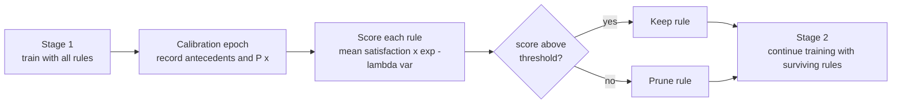

# Two-Stage LTN with Rule Pruning for Predictive Process Monitoring


Official code for the paper

<<<<<<< HEAD
Code for the paper
> **Neuro-Symbolic Learning for Predictive Process Monitoring via Two-Stage Logic Tensor Networks with Rule Pruning**

Given the prefix of a running case (its first events), a neural predicate P predicts the outcome of the case:
whether a loan is accepted, a patient goes to the ICU, or a fine is sent for credit collection. Domain knowledge is
injected into P with [Logic Tensor Networks](https://github.com/tommasocarraro/LTNtorch) (LTN):

- **logical rules** on the data and the label, e.g. *patients with lactic acid > 2 should be admitted to the ICU*.
  Since background knowledge is often imperfect, the rules that do not fit the data are **pruned** after a
  calibration phase (two-stage training) or **down-weighted** during training (adaptive rule weights);
- optionally, **Declare (control-flow) constraints** on the order of the activities, e.g. *ER Sepsis Triage
  immediately follows ER Triage*, mined from the training log or hand-written.

The models are evaluated on predictive performance and on **compliance**: how often the predictions agree with the
rules.
=======
> **Neuro-Symbolic Learning for Predictive Process Monitoring via Two-Stage Logic Tensor Networks with Rule Pruning**

The repository combines data-driven sequence models (LSTM / Transformer) with background knowledge expressed in first-order fuzzy logic, using [Logic Tensor Networks](https://github.com/logictensornetworks/LTNtorch) (LTN). Since hand-written rules are not always reliable, training is organised in **two stages**: all rules are used at first, then the unreliable ones are **pruned** and training continues with the surviving knowledge only.

---

## Table of contents

- [Overview](#overview)
- [Repository structure](#repository-structure)
- [Installation](#installation)
- [Datasets](#datasets)
- [Running the experiments](#running-the-experiments)
- [Multiple seeds](#multiple-seeds)
- [Declarative constraints as FOL formulas](#declarative-constraints-as-fol-formulas)
- [Citation](#citation)

---

## Overview

Each prefix of a trace is classified by a backbone model `P(x)` (the LTN predicate). The loss combines two groups of fuzzy axioms:

- **Data axioms**: positive prefixes satisfy `P(x)`, negative prefixes satisfy `¬P(x)`.
- **Knowledge axioms**: for every rule `r`, `antecedent_r(x) → P(x)` (or `→ ¬P(x)` for negative rules).

```
loss = 1 − ( 0.8 · SAT(data axioms) + 0.2 · SAT(knowledge axioms) )
```

### Training variants

| Flag | Variant | Description |
|---|---|---|
| `--train_vanilla` | Vanilla | Plain LSTM / Transformer trained with BCE, no logic. |
| `--train_ltn_no_rules` | LTN w/o rules | LTN with the data axioms only. |
| `--train_ltn_no_pruning` | LTN w/ all rules | Data and knowledge axioms in a single aggregation. |
| `--train_ltn_no_pruning_weighted` | LTN weighted loss | Data / knowledge mixed with fixed coefficients, no pruning. |
| `--train_ltn_pruning` | **Two-stage LTN** | All rules in the first stage, then pruning of unreliable rules. |
| `--train_ltn_adaptive` | LTN-Adaptive | All rules kept; per-rule weights adjusted during training. |

### Two-stage training with rule pruning



A rule is scored by the mean satisfaction of its implication, penalised by the variance across examples: `score = mean · exp(−λ · var)`. Rules below the gate threshold are dropped for the rest of training. Model selection uses the validation F1.

### Adaptive rule weighting

As an alternative to hard pruning, the **LTN-Adaptive** variants (`LTN-Adaptive-L` for the LSTM backbone, `LTN-Adaptive-T` for the Transformer) keep the whole knowledge base and assign a global weight to every axiom, updated at the end of each epoch. After a warm-up with uniform weights, each rule is compared with the data objective through the cosine similarity between their gradients on the classification head. Weights follow an exponentiated-gradient update and enter a weighted p-mean aggregation of the satisfaction errors; a uniform floor is annealed towards zero so that harmful rules can fade out.

---

## Repository structure

```
.
├── main_sepsis.py              # experiments on Sepsis
├── main_bpi12.py               # experiments on BPIC2012
├── main_bpi17.py               # experiments on BPIC2017
├── main_traffic.py             # experiments on Traffic Fines
├── run_seeds.py                # run a script over several seeds, report mean ± std
├── metrics.py                  # evaluation metrics (accuracy, F1, precision, recall, compliance)
├── data/
│   ├── preprocess_sepsis.py
│   ├── preprocess_bpi12.py
│   ├── preprocess_bpi17.py
│   ├── preprocess_traffic.py
│   └── dataset.py              # dataset class and model configuration
├── model/
│   ├── lstm.py                 # LSTM backbone
│   └── transformer.py          # Transformer backbone
├── declare_ltn_templates.py    # Declare constraints as LTN predicates (in progress)
├── declare_to_fol_templates.pdf
└── knowledge_base.txt
```

---

## Installation

```bash
git clone https://github.com/FabrizioDeSantis/NeSy-PPM.git
cd NeSy-PPM

python -m venv .venv
source .venv/bin/activate

pip install torch LTNtorch numpy pandas scikit-learn
```

A GPU is used automatically when available.
>>>>>>> 4f36cb968508f65a40d28fa775e60de82d73c536

## Contents

- [Setup](#setup)
- [Quick start](#quick-start)
- [Datasets](#datasets)
- [Experiments](#experiments)
- [Knowledge](#knowledge)
- [Experimental protocol](#experimental-protocol)
- [Command-line options](#command-line-options)
- [Outputs](#outputs)
- [Repository structure](#repository-structure)
- [Extending](#extending)

## Setup

```bash
conda create -n nesyppm python=3.11
conda activate nesyppm
pip install -r requirements.txt     # pick the torch build matching your CUDA version
```

The processed event logs must be in `data_processed/` (see [Datasets](#datasets)). A GPU is used when one is
available.

## Quick start

```bash
# Every experiment on Sepsis, LSTM backbone, compliance split, seed 42
python main.py --dataset sepsis

# Rule pruning vs. the baselines, transformer backbone
python main.py --dataset bpi12 --model transformer --experiments vanilla ltn_no_pruning ltn_pruning

# Temporal split, five seeds (mean ± std is reported)
python main.py --dataset traffic --setting temporal --experiments ltn_adaptive --seeds 42 67 55 33 104

# The 10 best Declare constraints mined from the training prefixes, as extra inputs of P
python main.py --dataset bpi17 --experiments ltn_pruning --declare in_p

# Mine the Declare constraints only, without training
python mine_declare.py --dataset sepsis

# Regenerate knowledge_base.txt (all the knowledge, with statistics on the event logs)
python make_knowledge_base.py
```

`python main.py --help` lists every option.

## Datasets

<<<<<<< HEAD
| `--dataset` | File | Label 1 | Cases | Max prefix length |
|---|---|---|---|---|
| `bpi12` | `data_processed/bpi12.csv` | the loan application is accepted | 4,804 | 40 |
| `bpi17` | `data_processed/bpi17.csv` | the loan offer is accepted | 31,417 | 20 |
| `sepsis` | `data_processed/sepsis_2.csv` | the patient is admitted to the ICU | 784 | 13 |
| `traffic` | `data_processed/traffic_fines.csv` | the fine is sent for credit collection | 150,370 | 10 |

The original event logs: [BPIC2012](https://data.4tu.nl/articles/dataset/BPI_Challenge_2012/12689204),
[BPIC2017](https://data.4tu.nl/datasets/34c3f44b-3101-4ea9-8281-e38905c68b8d/1),
[Sepsis](https://data.4tu.nl/datasets/33632f3c-5c48-40cf-8d8f-2db57f5a6ce7/1),
[Traffic fines](https://data.4tu.nl/datasets/806acd1a-2bf2-4e39-be21-69b8cad10909/1).
=======
The event logs are public and can be downloaded from the 4TU repository:

| Log | Link |
|---|---|
| BPIC 2012 | [4TU](https://data.4tu.nl/articles/dataset/BPI_Challenge_2012/12689204) |
| BPIC 2017 | [4TU](https://data.4tu.nl/datasets/34c3f44b-3101-4ea9-8281-e38905c68b8d/1) |
| Sepsis | [4TU](https://data.4tu.nl/datasets/33632f3c-5c48-40cf-8d8f-2db57f5a6ce7/1) |
| Traffic fines | [4TU](https://data.4tu.nl/datasets/806acd1a-2bf2-4e39-be21-69b8cad10909/1) |

Place the CSV files in `data_processed/`. The expected file name is set by the `DATA_PATH` constant at the top of each `main_*.py` script. Raw logs are converted into prefix/label tensors by the corresponding `data/preprocess_*.py` module.
>>>>>>> 4f36cb968508f65a40d28fa775e60de82d73c536

`data/preprocess_<dataset>.py` (with the helpers of `data/common.py`) splits and encodes each log:
- **Split** (`--setting`) into train / validation / test cases:
  - `compliance` (default): the test set is built on purpose from cases that comply with the rules R1–R3, so the
    rules hold far more often on test than on train. The split depends on the seed and is deterministic.
  - `temporal`: chronological. The oldest 64% of the cases go to training, the next 16% to validation, the most recent
    20% to test (cases are ordered by their first event). Training cases still running when the validation period
    starts, and validation cases still running when the test period starts, are dropped, so no event used for
    training or model selection happens after the period it is evaluated on.
- **Encoding:** categorical attributes become integer codes (0 is padding); numerical attributes are min-max scaled,
  with the scalers fit on the training cases only.
- **Prefixes:** every prefix of every case (lengths 1 to n-1), truncated and padded to the max prefix length. A
  prefix is stored as one flat vector, feature by feature.

<<<<<<< HEAD
The columns `rule_1`, `rule_2`, `rule_3` of the processed logs mark, for every event of a case, whether the entire
trace of the case satisfies the antecedent of rule R1, R2 or R3 (see [Knowledge](#knowledge)); the consequent (the
label implied by the rule) is not considered. They decide which cases can go to the test set of the compliance split.
`make_rule_labels.py` computes them from the rules of `nesy/knowledge.py`:

```bash
python make_rule_labels.py                             # all datasets, written to data_processed/rule_labels/
python make_rule_labels.py --datasets bpi12 --inplace  # overwrite data_processed/bpi12.csv (original kept as .bak)
```

All the other columns are written back unchanged. Changing the rule columns changes the compliance split, and
therefore every result: overwrite the logs only on purpose.
=======
## Running the experiments

Each `main_*.py` script runs one or more training variants on one dataset and prints the test metrics.

```bash
python main_sepsis.py --model_type lstm --setting compliance --seed 42 \
    --train_vanilla --train_ltn_pruning --train_ltn_adaptive
```

### Options

| Argument | Default | Description |
|---|---|---|
| `--model_type` | `transformer` | Backbone: `lstm` or `transformer`. |
| `--setting` | `compliance` | Experimental setting: `compliance` or `temporal`. |
| `--seed` | `42` | Seed for parameters and data splitting. |
| `--num_epochs` | `50` | Training epochs of the vanilla model. |
| `--num_epochs_nesy` | `50` | Training epochs of the LTN models. |
| `--hidden_size` | `128` | Hidden size of the backbone. |
| `--num_layers` | `2` | Number of LSTM layers. |
| `--dropout_rate` | `0.1` | Dropout rate. |
| `--train_*` | off | Select the variants to run (see the table above). |
| `--results_path` | none | Dump the test metrics of all selected variants to a JSON file. |

Metrics reported on the test set: accuracy, macro F1, precision, recall and, for the LTN models, rule **compliance**.
>>>>>>> 4f36cb968508f65a40d28fa775e60de82d73c536

## Experiments

<<<<<<< HEAD
`--experiments` selects what to train and test (default: all of them).

| Experiment | Loss | Rules |
|---|---|---|
| `vanilla` | binary cross-entropy | none |
| `ltn_no_rules` | `1 - SatAgg(data axioms)` | none |
| `ltn_no_pruning` | `1 - SatAgg(data axioms, rule axioms)` | all, aggregated with the data axioms |
| `ltn_no_pruning_weighted` | `1 - (0.8 · SatAgg(data axioms) + 0.2 · SatAgg(rule axioms))` | all |
| `ltn_pruning` | weighted, as above | only the reliable ones after the calibration phase (two-stage) |
| `ltn_adaptive` | weighted, rule axioms aggregated with per-rule weights | all, weighted by usefulness |

The neural predicate P(x), the probability of label 1, is an LSTM (`--model lstm`, default) or a transformer
(`--model transformer`). The axioms are:
- the **data axioms** `Forall x+: P(x+)` and `Forall x-: Not(P(x-))`;
- one **rule axiom** per rule, `Forall x: R(x) -> P(x)`, or `Forall x: R(x) -> Not(P(x))` for the rules implying
  label 0.

**Rule pruning** (`ltn_pruning`, `RulePruner` in `nesy/experiments.py`):
1. During a calibration phase every rule is active.
2. In one epoch the truth of each rule's antecedent and P(x) are recorded on the training prefixes.
3. At the end of the phase each rule gets a reliability score `mean(I) · exp(-λ · var(I))`, with
   `I = R(x) -> P(x)` (or `-> Not(P(x))`).
4. Afterwards only the rules scoring above the dataset's threshold stay in the loss.

**Adaptive rule weights** (`ltn_adaptive`, `AlignmentRuleWeights`): after a 5-epoch warm-up with uniform weights,
each rule's weight is updated once per epoch.
1. The cosine between two gradients of the classification head is computed: the gradient of the rule's axiom on
   training batches, and the gradient of the data axioms on the validation set.
2. An exponentiated-gradient step is taken on per-rule logits.
3. Rules pulling against the data decay towards zero. A uniform floor, annealed to 0, keeps every rule alive at
   first.

**Declare constraints** (`--declare`) are never connected to the label. They can be added to every experiment:
- `--declare in_p`: their truth values on a prefix are extra inputs of P, i.e. P(x, C(x)).
- `--declare axioms`: they stay out of P and are axioms `Forall x: C(x)` of the knowledge base, aggregated with the
  data axioms. P does not appear in these axioms, so they do not change its gradients.

## Knowledge

[`knowledge_base.txt`](knowledge_base.txt) lists all the knowledge, with statistics (support, activation and
confidence, by label) on the entire traces of the train, validation and test cases and of the whole log. It is
generated by `make_knowledge_base.py` from the code, so it always matches what the models are trained with.

**Logical rules** are defined once, by feature name, in [`nesy/knowledge.py`](nesy/knowledge.py). There are two
kinds:

- **R1–R3**, the rules of NeSyPM-Compliance. Each has a `rule_k` column, so they shape the compliance split, and
  they define the compliance metric.
- **E1, …**, the additional rules of the original knowledge base. They are part of the optimization (axioms,
  gating scores, adaptive weights) but are not used by the compliance split.

| Dataset | R1–R3 | Additional rules |
|---|---|---|
| BPI12 | R1 amount < 10k → not accepted · R2 40k < amount ≤ 60k → not accepted · R3 resource 11169 or 10910 involved → not accepted | E1 O_CANCELLED at least 3 times → not accepted · E2 O_SENT_BACK occurs → not accepted |
| BPI17 | R1 amount < 20k, offer created with credit score → accepted · R2 offer created without credit score → not accepted · R3 amount > 20k, existing loan takeover → not accepted | E1 application type "New credit" → accepted |
| Sepsis | R1 lactic acid > 2 → ICU · R2 infection suspected, SIRS tachypnea and heart rate → ICU · R3 CRP before IV antibiotics and CRP > 100 → ICU | E1 a CRP measurement below 10 → ICU · E2 SIRS criteria 2 or more → ICU |
| Traffic | R1 paid less than the fine → credit collection · R2 penalty added → credit collection · R3 amount > 400 → credit collection | E1 vehicle class A → credit collection |

**Declare constraints** are defined in [`nesy/declare_knowledge.py`](nesy/declare_knowledge.py); the templates and
miners are in [`declare/`](declare). There are two sources (`--declare_source`):

- `mined` (default): the best constraints mined from the training prefixes.
  1. They are mined with pm4py.
  2. The candidates are filtered:
     - only prefix-safe templates are kept;
     - confidence must be ≥ 0.9;
     - the confidence must be the same under pm4py and under the LTN semantics;
     - redundant, transitively implied and duplicate constraints are removed.
  3. The rest are ranked by class gap |conf(label 1) − conf(label 0)|, and the top 10 are kept.
- `predefined`: the hand-written constraints R4–R6 (`Response` / `ChainResponse`), e.g.
  `ChainResponse(ER Triage, ER Sepsis Triage)`.

[`declare_to_fol_templates.pdf`](declare_to_fol_templates.pdf) gives the translation of the Declare templates into
first-order logic. `declare/templates.py` implements them as tensor operations, and `declare/ltn_predicates.py` as LTN
predicates.

## Experimental protocol

- **Same starting point:** for every seed (`--seeds`), each experiment starts from the same initialization and sees
  the batches in the same order.
- **Model selection:** after each epoch the model is scored on the validation set. The parameters with the best
  validation macro-F1 are kept, and training stops early after the dataset's patience without improvement. The test
  set is used once, at the end.
- **Determinism:** Python, NumPy and PyTorch are seeded, cuDNN is deterministic, and the train / validation / test
  split does not depend on Python's hash seed. Two runs with the same arguments give the same numbers.
- **Tuned settings** of each dataset, in `nesy/datasets.py`:

  | Dataset | Learning rate | Patience (vanilla / pruning / weighted / adaptive) | Pruning: calibration, threshold, λ |
  |---|---|---|---|
  | BPI12 | 1e-3 | 5 / 8 / 15 / 15 | statistics in epoch 2, scored after epoch 6, threshold 0.5, λ 1, fired prefixes only |
  | BPI17 | 1e-3 | 5 / 5 / 5 / 15 | statistics and score in epoch 1, threshold 0.4, λ 2, fired prefixes only |
  | Sepsis | 1e-4 for no_pruning, pruning, adaptive; 1e-3 otherwise | 8 / 8 / 8 / 10 | statistics and score in epoch 4, threshold 0.3, λ 1 |
  | Traffic | 1e-3 | 5 / 5 / 15 / 15 (no_pruning: 5) | statistics and score in epoch 6, threshold 0.6, λ 2 |

  `ltn_no_rules` (and `ltn_no_pruning`, except on Traffic) has no early stopping: it trains for every epoch, and the
  best validation epoch is kept.
- **Metrics:**
  - accuracy, and macro-averaged F1, precision and recall;
  - **compliance**: consider the (rule, test prefix) pairs where a rule R1–R3 fires and the true label agrees with it.
    Compliance is the fraction of those pairs where the prediction agrees too. It is reported overall and per rule
    (for the additional rules too).

## Command-line options

| Option | Default | Description |
|---|---|---|
| `--dataset` | required | `bpi12`, `bpi17`, `sepsis`, `traffic` |
| `--model` (`--model_type`) | `lstm` | backbone of P: `lstm` or `transformer` |
| `--experiments` | all | experiments to run, or `all` |
| `--setting` | `compliance` | `compliance` or `temporal` split |
| `--seeds` (`--seed`) | `42` | one run per seed |
| `--epochs` / `--epochs_ltn` | 50 / 50 | maximum epochs of vanilla / of the LTN experiments |
| `--batch_size` | 32 | |
| `--hidden_size`, `--num_layers` | 128, 2 | LSTM |
| `--model_dim`, `--transformer_layers`, `--num_heads` | 128, 1, 2 | transformer |
| `--dropout` | 0.1 | |
| `--declare` | `none` | `none`, `in_p` (inputs of P) or `axioms` (`Forall x: C(x)`) |
| `--declare_source` | `mined` | `mined` or `predefined` Declare constraints |
| `--declare_top_k`, `--declare_min_support`, `--declare_min_confidence`, `--declare_max_ltn_gap` | 10, 0.05, 0.9, 0.01 | selection of the mined constraints |
| `--output_dir` | `results` | where results are written |
| `--results_path` | none | also write the test metrics to this JSON file |

## Outputs

- `results/runs/<dataset>_<model>_<timestamp>.json`: arguments, library versions, rules, Declare constraints, and
  every metric (including per-rule compliance and confusion matrices) for each seed and experiment.
- `results/results.csv`: one row per (run, seed, experiment), appended. Convenient for building tables.
- `results/declare_<dataset>_<setting>_<source>_seed<seed>.json`: the Declare constraints used (with `--declare`).
- `--results_path <file>`: the test metrics as JSON, `{experiment: metrics}` for one seed (as expected by
  `run_seeds.py`, which runs one `main.py` process per seed), `{seed: {experiment: metrics}}` otherwise.

## Repository structure

```
main.py                    entry point: train and test the experiments
make_rule_labels.py        computes the rule_1..rule_3 columns of the processed logs
make_knowledge_base.py     generates knowledge_base.txt
knowledge_base.txt         the knowledge, with statistics on the event logs
mine_declare.py            stand-alone Declare mining on a dataset
run_seeds.py               one main.py process per seed, with mean / std
nesy/
  datasets.py              dataset registry (paths, tuned settings), loading, entire-trace encoding, data loaders
  knowledge.py             logical rules of each dataset (R1-R3 and additional rules)
  declare_knowledge.py     Declare constraints: mined (default) or predefined
  experiments.py           experiments, LTN axioms, rule pruning, adaptive rule weights, seeding, training loop
  evaluation.py            test metrics and compliance
model/
  inputs.py                flat prefix -> per-event vectors (embeddings, numerical features, Declare inputs)
  lstm.py, transformer.py  backbones of P
data/
  common.py                split (compliance / temporal), encoding and prefix helpers
  preprocess_<dataset>.py  features, compliance split and encoding of each dataset
  dataset.py               PyTorch dataset of prefixes
declare/                   Declare templates, miners (pm4py and tensor-based), LTN predicates
legacy/                    the previous per-dataset scripts, kept for reference (see legacy/README.md)
```

## Extending

- **A new rule:** add a `Rule` to the dataset's function in `nesy/knowledge.py`. With `split=False` it is used in the
  optimization only (axioms, pruning, adaptive weights); otherwise it also gets a `rule_k` column and counts in the
  compliance metric. Regenerate `knowledge_base.txt`, and, to use a changed R1–R3 for the split, the rule columns
  with `make_rule_labels.py`.
- **A new predefined Declare constraint:** add it to `PREDEFINED_CONSTRAINTS` in `nesy/declare_knowledge.py`. The
  template names are listed in `declare/templates.py`.
- **New tuned settings:** edit the dataset's `DatasetSpec` in `nesy/datasets.py` (learning rate and patience per
  experiment, pruning settings).
- **A new dataset:** write `data/preprocess_<name>.py` with `FEATURES`, `WINDOW_SIZE`, `create_test_set` and
  `encode_features` (see the existing ones), register it in `DATASETS` (`nesy/datasets.py`), and add its rules to
  `RULES` (`nesy/knowledge.py`).
=======
## Multiple seeds

`run_seeds.py` launches a script once per seed and aggregates the results into mean and standard deviation.

```bash
python run_seeds.py --script main_sepsis.py --seeds 0 1 2 3 4 \
    --model_type lstm --train_ltn_pruning --train_ltn_adaptive
```

Every argument that `run_seeds.py` does not recognise is forwarded to the script. Output is written to `results/`:

| File | Content |
|---|---|
| `seed_<k>.json`, `seed_<k>.log` | Raw metrics and full log of each run. |
| `all_runs.csv` | One row per seed, variant and metric. |
| `summary.csv`, `summary_table.csv` | Mean, standard deviation and `mean ± std` table. |

Runs are sequential, and finished seeds are cached, so an interrupted experiment can be resumed with the same command.

---

## Declarative constraints as FOL formulas

Control-flow knowledge is often expressed with [Declare](https://doi.org/10.1007/s00450-009-0057-9) templates. `declare_to_fol_templates.pdf` gives the translation of Declare constraints into first-order logic formulas that can be used as knowledge axioms in an LTN. `declare_ltn_templates.py` implements these templates as LTN predicates *(work in progress)*.

---

## Citation

If you use this code, please cite the paper:

```bibtex
@inproceedings{de2026neuro,
  title={Neuro-symbolic learning for predictive process monitoring via two-stage logic tensor networks with rule pruning},
  author={De Santis, Fabrizio and Park, Gyunam and Zanichelli, Francesco},
  booktitle={Pacific-Asia Conference on Knowledge Discovery and Data Mining},
  pages={104--118},
  year={2026},
  organization={Springer}
}
```

## Contact

For questions or issues, please open a GitHub issue.
>>>>>>> 4f36cb968508f65a40d28fa775e60de82d73c536
